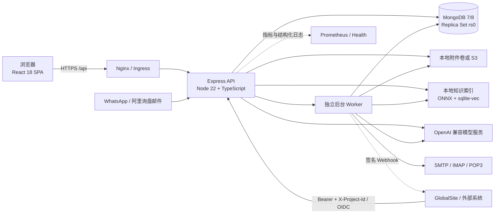

# GlobalCRM

**面向跨境 B2B 销售团队的自托管客户开发、全渠道沟通与成交管理平台。**

[](https://github.com/D77-jpg/GlobalCRM/actions/workflows/integration-release-gate.yml)
[](CHANGELOG.md)
[](https://nodejs.org/)
[](https://react.dev/)
[-47A248?logo=mongodb&logoColor=white)](https://www.mongodb.com/)
[](docs/operations/docker-runtime.md)

> **当前版本**：`v2.7.0`（2026-11-23）· **运行阶段**：团队内部本地化部署试运行 · **更新日志**：[CHANGELOG.md](CHANGELOG.md)

GlobalCRM is a self-hosted, multi-tenant B2B CRM engineered for cross-border trade and export sales teams. It unifies lead prospecting, customs trade intelligence, policy-grounded AI outreach, email & omnichannel inbox (WhatsApp & Alibaba inquiry parsing), dual-mode quotation/RFQ management, local RAG knowledge base, and external site integrations in a single auditable workspace.

---

## 目录

- [核心价值](#核心价值)
- [功能矩阵](#功能矩阵)
- [界面预览](#界面预览)
- [系统架构](#系统架构)
- [快速开始](#快速开始)
- [团队单业务本机部署](#团队单业务本机部署)
- [环境配置](#环境配置)
- [常用命令与测试验证](#常用命令与测试验证)
- [生产与容器化部署](#生产与容器化部署)
- [API 与 GlobalSite 集成](#api-与-globalsite-集成)
- [安全架构与数据边界](#安全架构与数据边界)
- [版本迭代与发布规范](#版本迭代与发布规范)
- [项目结构](#项目结构)
- [文档索引](#文档索引)
- [许可证与联系](#许可证与联系)

---

<p align="center">
  
</p>

## 核心价值

传统跨境外贸团队的销售流程往往分散在表格、个人邮箱、WhatsApp、平台询盘和零散的 AI 聊天窗口中，导致客户资产流失、开发信同质化、报价口径不一致。GlobalCRM 将完整销售链路收拢到可审计、可自托管的项目工作空间：

- **全链路工作台**：从潜客挖掘、海关贸易数据、AI 辅助开发信、三栏邮件副驾驶（Copilot）、全渠道询盘到双模式报价 / RFQ 成交，全程在单一工作区内闭环推进。
- **确定性规则与知识护栏**：所有 AI 写作与回复均受项目政策护栏（Policy Guardrails）、品牌行业卡（Brand Playbook）、产品目录与已发布知识库约束，提供引用溯源，杜绝模型编造交期、价格或资质。
- **合规触达与可追溯审计**：内置发送前审核、退订与抑制名单、RFC 8058 一键退订头、SPF/DKIM/DMARC 检查、邮箱预热与每日发送额度控制。
- **灵活部署模式**：既支持多项目集中式团队工作空间，也支持按业务线拆分独立数据包并在各业务电脑上本地 Docker 一键运行，所有数据与凭证严格隔离。

## 功能矩阵

| 模块 | 核心能力 |
| --- | --- |
| **客户与潜客管理** | 客户档案、联系人、标签、优先级、看板视图、Excel 批量导入、重复检查、跟进提醒、完整活动时间线与私有附件 |
| **潜客开发与海关数据** | 搜索画像、关键词候选池、公共池领取/退回、目标官网自动化调研、海关贸易数据导入与 AI 归因分析 |
| **AI 销售工作台（v2.7）** | 三栏邮件副驾驶（Mail Copilot）、回复场景选择器、长线程上下文自动裁剪、政策护栏校验、回复评分拆解、知识库即时问答 |
| **开发信与自动化触达** | 富文本编辑器、模板与占位符、品牌固定签名（防重复与 Logo 保留）、中英对照审校、品牌行业卡（Playbook）导入导出、多步自动触达（Shadow / Pilot / Active 灰度模式）与离线/在线质量评测 |
| **全渠道收件箱** | 独立三栏全渠道工作台，支持 WhatsApp（Meta Cloud API 接入及人工辅助模式）与阿里巴巴询盘邮件自动解析入池 |
| **邮件中心与合规** | 收件箱、发件队列、线程聚合、定时发送、失败核实与重试、IMAP / POP3 增量同步、SMTP / Mock 通道、退订与抑制名单、域名合规检查 |
| **产品目录与双模式报价** | 产品目录、缩略图、SKU、MOQ、参考价与阶梯价、批量导入、双模式报价 / RFQ 工作台、多币种报价单 PDF 导出、历史比价与报价核对 |
| **企业知识库与本地 RAG** | 文档上传、离线解析与分块、本地 ONNX 向量 + `sqlite-vec` + 词法混合检索与 Reranker 精排、事实核验、知识治理与维护脚本 |
| **组织权限与多业务隔离** | 组织 / 项目两级租户隔离、组织管理员 / 项目管理员 / 销售 / 只读 / 平台运营角色、套餐计量、单业务独立拆分导出与本机导入部署 |
| **GlobalSite 外部集成** | Integration API v1（C1 公开读接口、C2 自助服务凭证管理、J1/C3 询盘写入与回复草稿、C4 签名 Webhook 事件推送、C5 OAuth2 + PKCE / OIDC 身份提供端） |

## 界面预览

<p align="center">
  
</p>

## 系统架构



| 层次 | 技术栈 |
| --- | --- |
| **前端** | React 18、TypeScript 5.7、Vite 6、Tailwind CSS、Radix UI / shadcn、Zustand、React Router 7、React Quill |
| **后端** | Node.js `>= 22.12`、Express 4、TypeScript、Mongoose 8、Zod 4、`oidc-provider` 9.13 |
| **数据库** | MongoDB 7.x / 8.x（生产与事务特性需 Replica Set `rs0`） |
| **邮件与文档** | Nodemailer、ImapFlow、MailParser、SheetJS、Mammoth、PDF Parse、PDFKit |
| **AI 与本地检索** | 多 Provider 管理（OpenAI 兼容 / DeepSeek / GLM 等）、服务端加密密钥、Python + ONNX + `sqlite-vec` 本地语义索引 |
| **运维与部署** | Docker Compose v2、版本化 MongoDB 迁移（`001`–`018`）、独立 Worker、Prometheus 指标、备份恢复演练与单业务拆分工具 |

---

## 快速开始

### 环境要求

- **Docker 部署（推荐，团队本机与生产通用）**：Docker Engine + Docker Compose v2、Git
- **本地源码开发**：
  - Node.js `>= 22.12.0`（含 npm）
  - MongoDB `7.x` 或 `8.x`（默认 `127.0.0.1:27017`；涉及事务功能需启用副本集）
  - 可选：Python 3.12 及 `server/parsers`、`server/semantic` 本地模型资产（用于文档解析与语义检索）
  - 可选：SMTP / IMAP 邮箱账号（默认 `MAIL_TRANSPORT=mock`）

### 方式一：本地开发运行

```bash
# 1. 克隆仓库并安装依赖
git clone https://github.com/D77-jpg/GlobalCRM.git
cd GlobalCRM
npm install
npm run install:all

# 2. 复制后端环境变量模板（Windows PowerShell 使用 Copy-Item server\.env.example server\.env）
cp server/.env.example server/.env
```

编辑 `server/.env`，至少确认以下基础配置：

```dotenv
MONGODB_URI=mongodb://127.0.0.1:27017/cdlm
JWT_SECRET=请替换为至少32个字符的高熵随机字符串
ADMIN_USERNAME=admin
ADMIN_PASSWORD=请替换为安全的初始密码
APP_BASE_URL=http://localhost:5173
MAIL_TRANSPORT=mock
IMAP_ENABLED=false
```

执行数据库迁移并启动服务：

```bash
# 3. 执行版本化数据库迁移
npm run migrate --prefix server

# 4. 同时启动后端 API 与前端开发服务器
npm run dev
```

启动后访问：
- 前端工作台：`http://localhost:5173/`
- 后端 API：`http://127.0.0.1:5000/api`
- 健康检查：`http://127.0.0.1:5000/api/health`

如需在开发环境独立运行后台任务进程：

```bash
# 在 server/.env 中设置 RUN_BACKGROUND_JOBS=false
npm run dev:worker --prefix server
```

> `server/.env` 与 `.env.production` 均已被 `.gitignore` 忽略，严禁提交任何真实密钥、邮箱授权码或生产数据库连接串。

---

## 团队单业务本机部署

针对 **“一台电脑独立负责一条业务线（如 Genesis / IRONHUE / VELATURO）”** 的团队内部本地化部署场景，仓库提供完整的数据隔离拆分与一键导入工具：

1. **在主控机导出各业务独立数据包**（只读读取当前集成环境，为每台电脑生成独立强密钥并重加密邮箱 / AI / 渠道凭证，严格过滤并校验零跨项目数据泄露）：
   ```bash
   node scripts/export-project-bundles.cjs --out deploy-bundles --force
   ```
2. **在目标业务电脑拉取代码并运行一键导入脚本**（Windows PowerShell 示例）：
   ```powershell
   git clone https://github.com/D77-jpg/GlobalCRM.git
   cd GlobalCRM
   powershell -ExecutionPolicy Bypass -File "D:\GlobalCRM-Deploy\<业务目录>\import-project-bundle.ps1" -BundleDir "D:\GlobalCRM-Deploy\<业务目录>" -RepoDir "."
   ```
3. **后续随 GitHub 迭代升级**：
   ```powershell
   git pull origin main
   docker compose -p globalcrm-<业务标识> --env-file .env.production up -d --build --wait
   ```

完整操作步骤、校验机制、跨平台命令（Windows / macOS / Linux）及升级注意事项见：[团队单业务本机部署与拆分指南](docs/operations/single-project-local-deploy.md)。

---

## 环境配置

完整配置模板见 [`server/.env.example`](server/.env.example)、[`web/.env.example`](web/.env.example) 与 [`production.env.example`](production.env.example)。核心变量如下：

| 变量 | 默认值 | 说明 |
| --- | --- | --- |
| `NODE_ENV` | `development` | 运行模式：`development` / `test` / `production` |
| `APP_ENV` | `development` | 环境标识：`development` / `staging` / `production` |
| `MONGODB_URI` | `mongodb://127.0.0.1:27017/cdlm` | MongoDB 连接地址（生产需带 `authSource=admin&replicaSet=rs0`） |
| `PORT` | `5000` | 后端 API 监听端口 |
| `JWT_SECRET` | 无 | 会话令牌签名密钥，生产环境至少 32 位高熵随机值 |
| `ADMIN_USERNAME` | `admin` | 首次初始化管理员用户名 |
| `ADMIN_PASSWORD` | 无 | 管理员初始密码，生产环境至少 16 位高熵随机值 |
| `MAIL_CREDENTIAL_ENCRYPTION_KEY` | 无 | 邮箱、AI 与渠道加密密钥，生产环境必须独立配置且至少 32 位 |
| `COOKIE_SECURE` | `true`（生产） | HTTPS 生产环境保持 `true`；纯本机 HTTP 试运行可设为 `false` |
| `CORS_ORIGIN` | `http://localhost:5173` | 允许的前端来源，多个值以英文逗号分隔 |
| `PUBLIC_BASE_URL` / `TRACKING_BASE_URL` | 空 | 邮件静态资源与退订/追踪链接的对外根地址 |
| `MAIL_TRANSPORT` | `mock` | 系统级默认发件通道：`mock` 或 `smtp`（业务成员邮箱由工作台独立加密配置） |
| `STORAGE_PROVIDER` / `UPLOAD_DIR` | `local` / `server/uploads` | 附件存储引擎（`local` 或 `s3`）与本地路径 |
| `RUN_BACKGROUND_JOBS` | `true`（开发） | API 是否内嵌后台任务；Docker 生产编排默认拆分为独立 `worker` |
| `GLOBALCRM_HTTP_PORT` | `8080` | Docker Compose 宿主机回环监听端口（`127.0.0.1:<port>`） |
| `KNOWLEDGE_PYTHON` / `KNOWLEDGE_MODEL_DIR` | 空 | 可选本地知识库解析与 ONNX 语义检索运行时路径 |
| `OIDC_ENABLED` | `false` | 可选 GlobalSite C5 OIDC 身份提供端开关 |

前端构建期变量（修改后需重新构建 `web`）：

| 变量 | 默认值 | 说明 |
| --- | --- | --- |
| `VITE_API_BASE_URL` | `/api` | 浏览器访问 API 的基础路径（经 Nginx 同源代理） |
| `VITE_API_PROXY_TARGET` | `http://127.0.0.1:5000` | 仅 Vite 开发模式生效的代理目标 |
| `VITE_APP_TITLE` | `GlobalCRM` | 浏览器标题与工作台展示名称 |

---

## 常用命令与测试验证

### 开发与构建

| 命令 | 说明 |
| --- | --- |
| `npm run dev` | 同时启动后端 API 与前端 Vite 开发服务 |
| `npm run dev:server` / `npm run dev:web` | 单独启动后端或前端开发服务 |
| `npm run dev:worker --prefix server` | 启动开发模式独立后台 Worker |
| `npm run build` | 构建服务端（`server/dist`）与前端（`web/dist`） |
| `npm start` | 启动构建后的后端 API |
| `npm run start:worker --prefix server` | 启动构建后的独立后台 Worker |
| `npm run migrate --prefix server` | 执行待运行的数据库迁移 |
| `npm run migrate:status --prefix server` | 查看数据库迁移状态 |
| `npm run ops:verify-upgrade --prefix server` | 校验副本集事务、索引与品牌包升级状态 |
| `npm run brand:export --prefix server -- <dir>` | 导出内置品牌行业包到私有目录 |

### 质量与安全回归

```bash
# 类型检查、构建与前端 Lint
npm run typecheck
npm run build
npm run lint

# 核心服务端与契约测试
node scripts/check-integration-contract.cjs
node --test scripts/docker-runtime.test.cjs scripts/mongo-backup.test.cjs scripts/project-bundle.test.cjs
npm run test:integration --prefix server
npm run test:security --prefix server
npm run test:health --prefix server
npm run test:workbench --prefix server
npm run test:p3 --prefix server
```

CI 门禁定义位于 [`.github/workflows/integration-release-gate.yml`](.github/workflows/integration-release-gate.yml)，覆盖服务端核心业务、契约冻结、安全加固、知识库检索评测、P3 端到端主流程及 Docker Compose 事务迁移实测。

---

## 生产与容器化部署

```powershell
# 1. 从模板创建 .env.production（位于仓库根目录，已被 Git 忽略）
Copy-Item production.env.example .env.production
# 编辑 .env.production，替换全部占位密钥并确认端口/域名配置

# 2. 校验编排语法（勿使用不带 --quiet 的 config 输出到日志）
docker compose -p globalcrm --env-file .env.production config --quiet

# 3. 构建并启动（自动先执行一次性 migrate，再启动 server / worker / web）
docker compose -p globalcrm --env-file .env.production up -d --build --wait
```

默认编排仅将 Web 服务绑定在 `127.0.0.1:${GLOBALCRM_HTTP_PORT:-8080}`，API 与 MongoDB 位于内部网络且不对宿主机开放端口。面向公网部署时，必须在宿主机前置独立 HTTPS 反向代理（终止 TLS 并透传标准代理头）。

运维手册：
- [Docker 容器运行说明](docs/operations/docker-runtime.md)
- [MongoDB 备份与隔离恢复演练](docs/operations/mongo-backup.md)
- [团队单业务本机部署与拆分指南](docs/operations/single-project-local-deploy.md)
- [环境、迁移与发布规范](docs/P3-环境与发布.md)

---

## API 与 GlobalSite 集成

后端默认提供以下基础探针与集成路由：

| 路由 | 说明 |
| --- | --- |
| `GET /api/health/live` | 进程存活探针（不依赖数据库） |
| `GET /api/health/ready` | 严格就绪检查（数据库可用且未进入 draining） |
| `GET /api/health` | 综合健康状态（数据库、内存、邮件通道、版本号） |
| `/api/integrations/v1/*` | GlobalSite 与外部系统集成接口（独立服务凭证认证） |
| `/oidc/*` | 可选 GlobalSite C5 OAuth2 + PKCE S256 / OIDC 身份提供端 |

**认证模型分离**：
- **浏览器工作台**：使用 HttpOnly Cookie（`cdlm_access` / `cdlm_refresh`），写请求配合 Double-Submit CSRF（`cdlm_csrf` + `X-CSRF-Token`）与显式项目头 `X-Project-Id`。
- **外部业务集成**：使用项目级服务凭证（`Authorization: Bearer <token>` + `X-Project-Id`），权限按 Scope 严格受限。
- **身份登录提供端（C5）**：与业务服务凭证彻底隔离，不接受 CRM JWT 或业务服务凭证。

**GlobalSite 对接能力总览**（唯一机器契约以 [`docs/integration/integration-v1.openapi.yaml`](docs/integration/integration-v1.openapi.yaml) 为准）：
- **C1 公开读接口**：仅导出经运营审核公开的产品目录、公司资料与补充材料，不泄露内部话术、价格策略或原始文档。
- **C2 自助凭证管理**：项目管理员在「项目工作空间 → 集成与连接」创建、轮换（最长 7 天宽限期）与吊销服务凭证；明文令牌仅显示一次。详见 [C2 凭证管理](docs/integration/C2-凭证管理.md)。
- **J1 / C3 询盘写入**：支持幂等询盘写入、客户来源筛选、站内负责人提醒、异步安全拉取私有附件及待审回复草稿生成（不自动外发）。详见 [J1 / C3 询盘写入](docs/integration/J1-C3-询盘写入.md)。
- **C4 Webhook 事件推送**：可选项目级配置（默认关闭），基于原始请求体 HMAC-SHA256 签名（±300s 防重放）、公网 HTTPS 与固定 DNS/IP 防 SSRF、租约围栏与失败重发。详见 [C4 Webhook](docs/integration/C4-webhook.md)。
- **C5 OAuth2 / OIDC 身份提供端**：默认关闭；启用需 Node `>= 22.12`、MongoDB 事务副本集、迁移 `011`、专用签名 Keyring 与可信 HTTPS 入口。详见 [OAuth 设计](docs/integration/oauth-设计.md) 与 [OAuth 部署说明](docs/integration/oauth-部署.md)。

---

## 安全架构与数据边界

- **多租户强隔离**：全部业务模型注册租户插件强制附加组织过滤，并结合显式项目上下文二次校验。
- **凭证静态加密**：用户邮箱授权码、AI 服务商密钥、全渠道 Token 等敏感字段按独立用途派生 AES-256-GCM 密钥落库，禁止明文存储或回传。
- **附件访问控制**：附件目录不作为静态资源暴露，全部经鉴权与项目归属核验后流式下载。
- **合规发件机制**：开发信默认附带可见退订链接与标准 `List-Unsubscribe` 头，退订、硬退信与投诉自动写入抑制名单；邮件追踪仅保存令牌摘要。
- **敏感数据禁入仓库**：`.env`、`.env.production`、`server/uploads/`、`deploy-bundles/`、数据库备份、真实客户表格及含客户信息的截图严禁提交至 Git。

如发现安全漏洞，请勿在公开 Issue 披露细节，请发送邮件至 `support@genesisgroup.cn`，并在标题注明 `[GlobalCRM Security]`。

---

## 版本迭代与发布规范

GlobalCRM 采用 [语义化版本控制（SemVer 2.0.0）](https://semver.org/lang/zh-CN/) 管理迭代：

- **`MAJOR.MINOR.PATCH`**（当前：`2.7.0`）：
  - **PATCH**（如 `2.7.1`）：缺陷修复、安全补丁、文案与文档修正，向后兼容。
  - **MINOR**（如 `2.8.0`）：新增业务模块、工作台能力或向后兼容的数据库迁移。
  - **MAJOR**（如 `3.0.0`）：不兼容的架构或协议升级。
- **分支与合并流程**：
  1. 从最新 `main` 切出功能或修复分支，严禁直接推送 `main`。
  2. 同步更新根目录、`server/`、`web/` 的 `package.json` 版本号、`server/src/controllers/stats.controller.ts` 中的 `APP_VERSION` 及 [`CHANGELOG.md`](CHANGELOG.md)。
  3. 通过全部类型检查、构建、Lint、契约冻结检查与相关自动化测试后提交 PR 合并至 `main`。
  4. 在 GitHub 打对应版本 Tag（如 `v2.7.0`）并发布 Release Notes。
  5. 各本机部署节点通过 `git pull origin main` + `docker compose -p <project> --env-file .env.production up -d --build --wait` 平滑升级（`migrate` 容器会自动按序执行新增迁移）。

---

## 项目结构

```text
GlobalCRM/
├── server/                     后端 API 与独立 Worker（Node 22 + Express + Mongoose）
│   ├── src/
│   │   ├── background/         后台任务调度与 Worker 运行时
│   │   ├── config/             环境变量校验、数据库连接与结构化日志
│   │   ├── controllers/        HTTP 控制器
│   │   ├── middleware/         鉴权、CSRF、租户上下文、限流与错误处理
│   │   ├── migrations/         版本化 MongoDB 迁移脚本（001–018）
│   │   ├── models/             Mongoose 模型与租户隔离插件
│   │   ├── routes/             REST、Integration API v1 与 OIDC 路由
│   │   ├── services/           客户、邮件、AI Copilot、全渠道、知识库、报价与存储服务
│   │   ├── scripts/            迁移、品牌包导出、凭证运维与校验脚本
│   │   └── worker.ts           独立后台 Worker 入口
│   ├── tests/                  服务端自动化测试与 UI 回归测试
│   ├── evaluation/             开发信与知识库离线/在线评测框架
│   ├── parsers/                本地文档解析适配器
│   ├── semantic/               本地 ONNX + sqlite-vec 语义检索运行时
│   └── .env.example            后端开发环境变量模板
├── web/                        前端 SPA（React 18 + Vite 6 + Tailwind + Radix UI）
│   ├── src/components/         通用 UI 与业务工作台组件
│   ├── src/pages/              客户、工作台、全渠道、报价、知识库与集成管理页面
│   ├── src/router/             路由与角色守卫
│   ├── src/store/              Zustand 状态管理
│   └── nginx.conf              生产静态托管与 /api 反向代理配置
├── scripts/                    契约校验、备份恢复、单业务拆分导出与导入脚本
├── docs/                       架构设计、验收报告、集成契约与运维手册
├── compose.yaml                Docker Compose 单机生产编排
├── production.env.example      生产环境变量模板
├── CHANGELOG.md                版本变更记录
└── package.json                Monorepo 根脚本与版本声明
```

## 文档索引

- **版本与发布**：[CHANGELOG.md](CHANGELOG.md) · [环境、迁移与发布](docs/P3-环境与发布.md) · [品牌与命名规范](docs/brand-guidelines.md)
- **运维与部署**：[团队单业务本机部署与拆分指南](docs/operations/single-project-local-deploy.md) · [Docker 运行说明](docs/operations/docker-runtime.md) · [MongoDB 备份与恢复](docs/operations/mongo-backup.md)
- **外部集成**：[Integration API v1 总览](docs/integration/README.md) · [OpenAPI 契约](docs/integration/integration-v1.openapi.yaml) · [C2 凭证管理](docs/integration/C2-凭证管理.md) · [J1/C3 询盘写入](docs/integration/J1-C3-询盘写入.md) · [C4 Webhook](docs/integration/C4-webhook.md) · [C5 OAuth 部署](docs/integration/oauth-部署.md)
- **业务与 AI**：[知识库与销售 Agent 路线](docs/knowledge-agent-roadmap.md) · [自动开发设计](docs/outreach-autopilot.md) · [产品目录与报价核对](docs/product-quote-playbook.md) · [今日开发与潜客导入](docs/prospecting-profiles-and-import.md)
- **质量与安全**：[安全测试与渗透测试清单](docs/P3-安全测试与外部渗透测试清单.md) · [压力与稳定性测试报告](docs/P3-压力与稳定性测试报告.md)

## 许可证与联系

- **许可证**：本仓库当前尚未附带开源许可证文件，默认保留所有权利（All Rights Reserved），仅限团队内部授权使用与二次开发。正式开源前将明确选定并提交 `LICENSE` 文件。
- **协作约定**：提交 PR 请遵循 Conventional Commits（如 `feat:`、`fix:`、`docs:`、`chore:`），保持单 PR 聚焦单一目标，切勿在代码、测试或截图中包含真实客户信息与凭证。
- **产品与安全联系**：`support@genesisgroup.cn`（安全问题请在邮件标题注明 `[GlobalCRM Security]`）。
