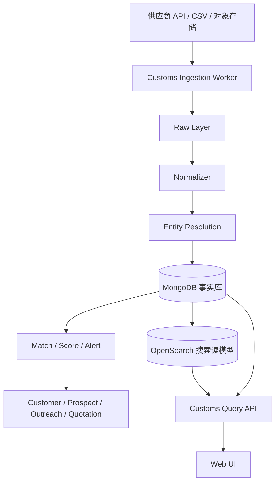

# GlobalCRM 海关数据完整闭环方案

**状态：** 已确认，进入实施
**范围：** 欧美优先，架构支持后续国家扩展
**目标：** 把海关数据变成获客、客户经营、预警、开发和成交复盘的完整业务闭环
**最后更新：** 2026-11-09

## 1. 目标与边界

海关数据层不是独立的查询工具，而是 GlobalCRM 的贸易情报基础设施。它需要回答四个业务问题：

1. 哪些公司正在进口我们的目标产品？
2. 这个客户最近从哪里采购、采购了多少、供应商有没有变化？
3. 哪个客户或买家现在值得优先跟进？
4. 某条海关记录能否成为开发信和报价的可追溯依据？

完整业务闭环：

```text
发现买家
  → 公司画像
  → 加入潜客池
  → 分配业务员
  → 开发信/跟进
  → 客户回复
  → 报价
  → 成交/复购
  → 结果回流到评分和复盘
```

海关数据不替代联系人数据。海关记录通常不包含邮箱和联系人姓名，邮箱仍需通过现有网站抓取、Hunter、人工补充或客户提供的方式获取。

## 2. 产品结构

### 2.1 贸易情报

新增一级菜单，包含四个工作区：

- **买家发现：** 按产品、HS Code、国家、金额、时间发现进口商。
- **公司搜索：** 直接搜索进口商、出口商、供应商和品牌。
- **市场洞察：** 按国家、HS、时间观察市场规模和变化。
- **监控预警：** 查看已监控客户和买家的贸易变化。

### 2.2 公司 360

公司档案必须包含：

- 基本信息：名称、别名、国家、地址、域名、VAT/EORI
- 12 个月进口趋势
- 进口产品结构和 HS 分布
- 主要供应商和供应商集中度
- 最近发货记录
- 起运港、目的港、运输方式
- 关联 CRM 客户/潜客
- 监控、加入潜客池、发起开发
- 数据来源、覆盖状态、最后更新时间

### 2.3 客户详情贸易动态

在客户详情页新增“贸易动态”Tab：

- 最近 12 个月进口趋势
- 主要采购产品
- 供应商变化
- 采购量上升或下降
- 与当前产品/报价的匹配度
- 贸易事件时间线
- 基于海关记录生成跟进建议

### 2.4 预警和待办

预警类型：

- 客户出现新进口记录
- 新买家首次进口
- 客户更换供应商
- 客户采购量明显下降
- 目标市场出现高匹配买家
- 监控公司出现新的 HS 产品

预警进入站内通知、每日摘要和业务员待办。预警不直接发送开发信。

## 3. 数据源策略

### 3.1 原则

- 只采购有合法商业授权和再分发许可的数据。
- 不爬取海关网站。
- 供应商 API、CSV 导入和对象存储文件都通过统一适配层进入系统。
- 供应商差异不能渗透到业务表，业务层只依赖标准化后的数据。

### 3.2 欧美覆盖

美国优先使用提单/进口记录，字段通常包括进口商、发货人、HS Code、产品描述、重量、数量、金额、港口和日期。

欧洲不能假设所有国家都有同等明细。第一阶段优先评估：

- 德国
- 法国
- 意大利
- 西班牙
- 荷兰
- 波兰
- 比利时

供应商评估必须提供以下矩阵：

| 项目 | 要求 |
| --- | --- |
| 国家 | 每个国家的覆盖状态 |
| 字段 | 哪些字段真实可用 |
| 更新频率 | 日更、周更或月更 |
| 数据延迟 | 最近记录日期 |
| 授权 | API、缓存、SaaS 嵌入、导出 |
| 联系人 | 是否包含联系人字段 |
| 价格 | 查询、记录、导出或年度授权 |

### 3.3 供应商策略

采用一主一辅：

- 主供应商覆盖美国和主要欧洲国家。
- 补充供应商补欧洲字段或国家缺口。
- 每个来源保留独立 sourceId 和覆盖配置。
- 同一票记录通过来源记录 ID 和业务指纹去重。
- 冲突字段按来源优先级和数据新鲜度决定。

候选供应商包括 Panjiva、ImportGenius、Datamyne、Volza、Export Genius 和 Tendata。候选名单不代表最终选型，必须用真实样本和合同条款验证。

## 4. 技术架构



### 4.1 组件职责

| 组件 | 职责 |
| --- | --- |
| Ingestion Worker | 同步、游标、限流、重试、幂等 |
| Raw Layer | 保存供应商原始文件或原始记录，便于重放 |
| Normalizer | 国家、币种、单位、HS、公司名标准化 |
| Entity Resolution | 公司别名、域名、地址、VAT/EORI 合并 |
| Search Read Model | 多条件检索、聚合和排序 |
| Match Service | 海关公司与 CRM 客户/潜客匹配 |
| Score Service | 可解释的线索评分 |
| Alert Service | 贸易变化检测和通知 |
| Usage Service | 查询、导出和记录用量 |

### 4.2 技术选择

- MongoDB 保存事实数据和关联关系。
- OpenSearch 作为搜索和聚合读模型。
- 原始文件进入对象存储，生产环境使用 S3 兼容存储。
- 所有模型使用 tenant 插件，强制组织和项目隔离。
- 供应商凭证只保存在服务端加密配置中。
- 背景任务使用现有 worker 运行模型，提供租约和幂等保护。

## 5. 数据模型

完整字段和索引见 `docs/customs-data-dictionary.md`。

核心集合：

| 集合 | 作用 |
| --- | --- |
| `customs_sources` | 供应商、授权、凭证和同步配置 |
| `customs_source_coverage` | 国家、字段、更新频率和覆盖状态 |
| `customs_companies` | 标准化进口商/出口商 |
| `customs_company_aliases` | 公司别名、地址、域名和税号 |
| `customs_company_profiles` | 公司聚合画像和趋势 |
| `customs_shipments` | 每票海关/提单记录 |
| `customs_matches` | 海关公司与 CRM 实体匹配 |
| `customs_watches` | 客户、公司和市场监控 |
| `customs_alerts` | 贸易变化预警 |
| `customs_scores` | 线索评分和解释 |
| `customs_usage` | 查询、导出、记录用量 |
| `customs_sync_jobs` | 同步任务、游标和错误 |

现有模型扩展：

- `Product` 增加 `hsCode`、`hsCodeSource`、`customsKeywords`
- `Prospect.source` 增加 `customs`
- `Customer` 增加 `customsCompanyId`、`customsMatchConfidence`
- `CustomerEvent` 增加 `customs_activity`

## 6. 匹配和评分

### 6.1 公司匹配

匹配优先级：

1. 域名完全匹配
2. VAT/EORI 完全匹配
3. 标准化公司名完全匹配
4. 公司名 + 国家 + 地址匹配
5. 模糊匹配

每条匹配必须保存：

- 匹配方式
- 置信度
- 证据字段
- 人工确认状态
- 操作人和时间

禁止自动合并两个 CRM 客户。

### 6.2 线索评分

评分维度：

- 最近采购时间
- 采购频率
- 采购金额/规模
- 采购增长
- 产品匹配度
- 供应商集中度
- 市场优先级

评分必须可解释。每个分数都要有原因和关联记录。

## 7. AI 和开发闭环

AI 可以：

- 总结公司贸易画像
- 识别采购变化
- 推荐开发切入点
- 生成带海关记录引用的开发信角度
- 推荐下一步跟进动作

AI 不可以：

- 编造不存在的海关记录
- 自动发送开发信
- 绕过现有审核、退订和抑制机制
- 把其他项目的数据带入当前项目

## 8. 权限和合规

### 权限

- 管理员：配置数据源、同步、查看用量、管理导出权限
- 业务员：搜索、查看公司档案、转潜客、监控客户、生成跟进建议
- 只读角色：只查看被授权项目的数据
- 原始批量导出：默认仅管理员

### 合规

- 供应商合同必须允许 API、缓存、SaaS 嵌入和业务使用。
- 欧盟数据做 GDPR 影响评估。
- 个人信息最小化，不采集与业务无关的联系人数据。
- 海关记录不能替代开发信订阅和退订同意。
- 开源仓库只保留接口、Mock 和合成数据。
- 真实海关数据、凭证和导出文件不得进入仓库、日志或测试快照。

## 9. 交付阶段

| 阶段 | 内容 | 预计 |
| --- | --- | --- |
| 阶段一 | 数据模型、迁移、来源适配接口、CSV 导入、标准化、基础查询 API | 3 至 4 周 |
| 阶段二 | 贸易情报搜索、公司 360、加入潜客池、客户匹配 | 3 至 4 周 |
| 阶段三 | 客户详情贸易动态、监控、预警、每日摘要 | 3 周 |
| 阶段四 | 评分、AI 总结、开发信联动、报价/成交归因 | 3 至 4 周 |
| 阶段五 | 欧洲缺口供应商、更多国家、运营工具和成本优化 | 持续 |

每一阶段都必须交付可运行的功能，不以“只有后端”或“只有页面”作为阶段完成。

## 10. 验收标准

- 海关记录按项目和来源幂等导入，重复导入不产生重复数据。
- 公司匹配结果有置信度和证据，错误匹配可人工纠正。
- 客户详情能看到贸易动态，数据来源和日期可见。
- 加入潜客池后保留海关来源和原始公司关联。
- 预警可按规则触发，不自动发送开发信。
- 所有查询和导出受项目权限和套餐额度控制。
- 搜索、公司档案、客户贸易动态和潜客转化形成完整闭环。
- 真实数据不进仓库、日志、截图和测试快照。

## 11. 当前实施顺序

1. 建立 `customs_*` 模型和迁移。
2. 实现来源适配接口、CSV 导入和标准化服务。
3. 实现搜索、公司档案和客户匹配基础 API。
4. 实现贸易情报页面和客户详情贸易动态。
5. 接入监控、预警、评分和 AI。
6. 接入真实供应商前完成样本验收、法务和成本核算。
